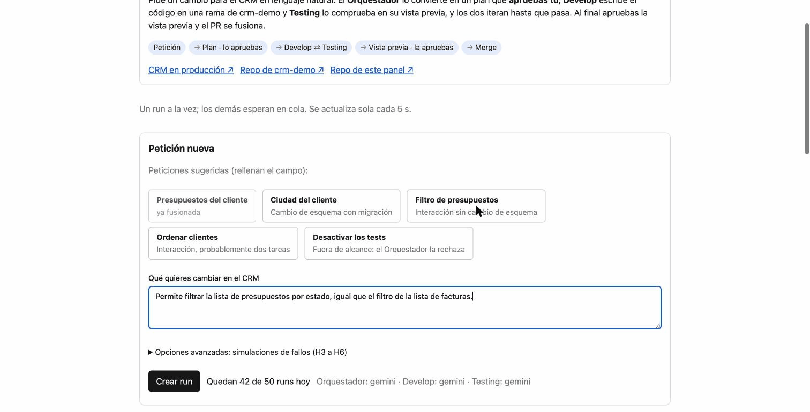
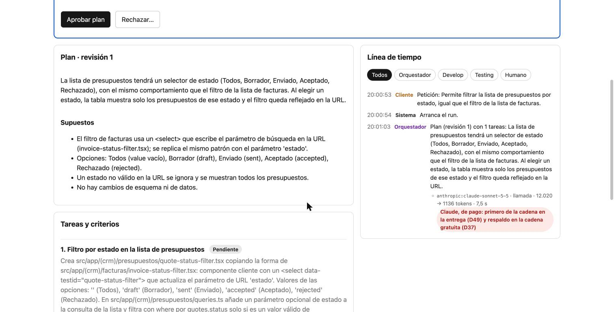
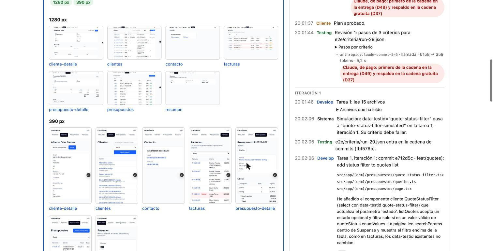
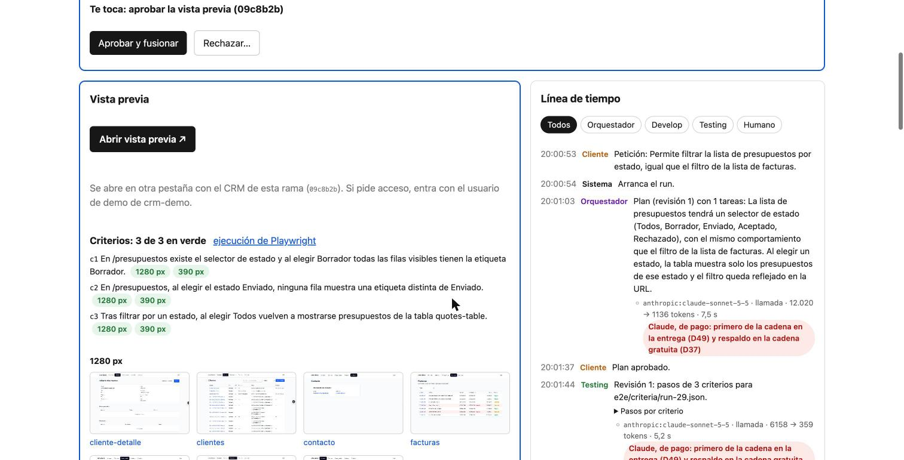
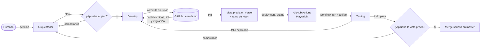

# crm-agents

Prueba técnica para Speed Paradigm: tres agentes de IA (**Orquestador**, **Develop** y **Testing**) y un humano que aprueba modifican un mini CRM (clientes, presupuestos y facturas) a partir de peticiones en lenguaje natural.

- **Panel (este repo):** <https://crm-agents.vercel.app>. Contiene el motor de runs, los agentes y la UI.
- **CRM que modifican:** [`crm-demo`](https://github.com/daboy-dev/crm-demo), en producción en <https://crm-demo-daboy-dev.vercel.app>.

Las credenciales del usuario de prueba se entregan aparte. No están en el repo.



*Run #29 con «Simular fallo de criterio»: Testing detecta el fallo en la iteración 1, Develop lo corrige en la 2 y el run queda esperando la aprobación final. Más capturas en [Cómo se ve un run](#cómo-se-ve-un-run).*

## Cómo probarlo

1. Entra en el panel con el usuario de prueba. Llegas a `/runs`.
2. Elige una de las **peticiones sugeridas** (rellenan el campo, no lo envían) o escribe la tuya, y envíala.
3. El **Orquestador** propone un plan con tareas y criterios de aceptación. **Apruébalo**, o devuélvelo con comentarios y lo rehace.
4. **Develop** escribe el código en la rama `run/<id>` de `crm-demo`, un commit por tarea, y abre un PR. Vercel crea una vista previa con su propia base de datos.
5. **Testing** comprueba cada criterio en esa vista previa con Playwright. Si alguno falla, explica el fallo a Develop, que lo corrige. Si una tarea no pasa en 3 iteraciones, se bloquea y decides tú: reintentar o abandonar.
6. Revisa la vista previa y las capturas a 1280 y 390 px, y **aprueba el merge**. El cambio llega a producción de `crm-demo` (D50).

Un run tarda unos minutos, sobre todo por los builds de Vercel. La página se actualiza sola. La última sugerencia, «Desactivar los tests», está fuera de alcance: sirve para ver cómo el Orquestador rechaza una petición sin crear rama.

**Deja abierta una página del panel (`/runs` o la del run) mientras trabaja.** No hay cron, porque Vercel Hobby solo lo ejecuta una vez al día. El run avanza con los webhooks de GitHub, y la página abierta retoma los pasos que se quedan a medias. Con la pestaña cerrada o en segundo plano, un run puede quedarse parado. Al volver a abrirla, sigue solo.

Para ver el bucle entre Develop y Testing sin esperar a que un modelo se equivoque, abre **Opciones avanzadas** en el formulario y marca «Simular fallo de criterio». El panel rompe un `data-testid` en la primera entrega de Develop, Testing explica el fallo y Develop lo corrige en la iteración siguiente.

### Cómo se ve un run

Capturas del run #29 ([crm-demo#33](https://github.com/daboy-dev/crm-demo/pull/33)).

**El plan que apruebas:** resumen, supuestos y tareas con sus criterios. A la derecha, la línea de tiempo con el modelo, los tokens y la latencia de cada llamada.



**El bucle entre Develop y Testing:** en la iteración 1 el panel simula el fallo de un `data-testid` y el criterio falla. Debajo de la vista previa están las capturas a 1280 y 390 px.



**La aprobación final:** los criterios en verde en los dos tamaños, el enlace a la vista previa y el botón que fusiona el PR.



## Cómo funciona



- **Máquina de estados en la base de datos (D21, D22).** Las funciones de Vercel duran como mucho 300 s, así que ningún paso espera a un build. Cada run es una fila con su estado, y avanza con los webhooks de GitHub (D4, D17) y con un `sweep()` que se ejecuta mientras el panel de un run está abierto, sin cron. Cada paso usa compare-and-swap con *lease*, así que repetirlo no duplica nada.
- **Un PR por run y un commit por tarea (D20).** Develop no ejecuta nada: devuelve archivos completos y el panel hace los commits con la Git Data API. `pr-check.yml` le devuelve los errores de tipos y lint, y genera la migración si cambia el esquema (D31, D33). Las tareas demasiado grandes se dividen (D34).
- **Testing no decide el veredicto (D38, D39).** El LLM escribe pasos declarativos por criterio. Un ejecutor fijo de `crm-demo` los lanza, y el resultado de Playwright es el veredicto. Los JSON de cada run fusionado quedan como regresión.
- **El humano aprueba en dos puntos (D9, D47):** el plan y la vista previa final. Cada acción envía exactamente lo que aprueba (revisión del plan o sha), así que no se puede aprobar algo que cambió mientras se miraba.
- **Un solo run activo a la vez y una cola (D11, D23).** Así se respetan las 10 ramas de Neon del plan gratuito.

## Agentes y modelos

Cada agente usa una cadena de `proveedor:modelo` (D36). Si un eslabón agota su cuota o no puede con la petición, se pasa al siguiente. Las salidas se validan con Zod y, si no cumplen el contrato, hay una llamada de reparación.

| Agente | Cadena por defecto (gratuita, con Claude de respaldo) | Cadena de la entrega (D49) |
|---|---|---|
| Orquestador | Gemini Flash → Claude → Groq | **Claude Sonnet** → Gemini → Groq |
| Develop | Gemini Flash → Claude | **Claude Sonnet** → Gemini |
| Testing | Gemini Flash → Groq → Claude | **Claude Sonnet** → Gemini → Groq |

El sistema se construyó y se comprobó con la capa gratuita de Gemini y Groq, y Claude solo como respaldo de pago (D37). Para la entrega, Claude va el primero, por fiabilidad: durante el desarrollo, los modelos gratuitos llegaron a estar agotados o saturados durante un run entero (run #25, sesión 15). Volver a la cadena gratuita no requiere código: basta con quitar las variables `LLM_CHAIN_*` en Vercel. El panel marca como «respaldo» cualquier llamada que no haya usado el primer modelo de la cadena.

Las evaluaciones de los prompts con la cadena gratuita están en [`docs/evals/`](./docs/evals).

## Límites conocidos

- **Despliegues de Vercel Hobby:** 100 al día por cuenta, sumando los dos proyectos. Un run genera unos 3–5, así que caben unos 20–30 runs al día, aunque `RUNS_PER_DAY` sea 50.
- **Un run activo:** las peticiones simultáneas esperan en la cola, que muestra su posición.
- **Llamadas al LLM por run:** 24 como máximo. Si un run las agota, se bloquea y decide el humano.
- **Solo criterios comprobables en el DOM (D39).** El aspecto visual lo revisa el humano con las capturas en la aprobación final.
- **Alcance de Develop (D16, D31, D38):** no puede tocar los workflows, las migraciones (las genera `pr-check`), la configuración de build, lint y tests, las dependencias ni el ejecutor de criterios.
- **Las capturas** se guardan en Vercel Blob privado y solo se ven tras el login.
- **Runs que esperan aprobación:** se cancelan solos a las 24 h, para no bloquear la cola (D23).
- **Sin cron:** retomar un paso que se ha quedado a medias necesita una página del panel abierta (D22).

## Cómo se construyó

- **Planificación y decisiones** en un Project de Claude (claude.ai). **Ahí es donde se tomaban de verdad las decisiones:** Claude proponía opciones, el humano elegía o las corregía, y de cada conversación salía el prompt de la siguiente sesión de Claude Code. El resultado son las 50 decisiones de [`docs/DECISIONES.md`](./docs/DECISIONES.md), cada una con su contexto, lo que propuso Claude, lo que decidió el humano y sus consecuencias.
- **Implementación con Claude Code**, una sesión por hito (H0–H8), con un criterio de verificación en producción que tenía que cumplirse para dar el hito por cerrado. [`CLAUDE.md`](./CLAUDE.md) da a cada sesión el contexto del proyecto.
- **Registro:** [`docs/PROCESO.md`](./docs/PROCESO.md) recoge cada sesión (objetivo, qué salió mal y qué se corrigió). En [`docs/sesiones/`](./docs/sesiones) están las transcripciones de las dos herramientas, intercaladas en orden y revisadas para quitar claves y datos personales:
  - **Project de Claude** (números pares): [00](./docs/sesiones/00-planificacion.md) planificación general, y [02](./docs/sesiones/02-planificacion-h1.md), [04](./docs/sesiones/04-planificacion-h2.md), [06](./docs/sesiones/06-planificacion-h3.md), [08](./docs/sesiones/08-planificacion-h4.md), [10](./docs/sesiones/10-planificacion-h5.md), [12](./docs/sesiones/12-planificacion-h6.md), [14](./docs/sesiones/14-planificacion-h7.md) y [16](./docs/sesiones/16-planificacion-h8.md), la planificación de cada hito de H1 a H8. La [18](./docs/sesiones/18-cierre.md) es el repaso final tras H8.
  - **Claude Code** (números impares, de la 01 a la 17): la implementación de cada hito.

## Stack

Next.js 16 (App Router) con TypeScript estricto en Vercel Hobby · Neon (Postgres) con Drizzle · Gemini, Groq y Anthropic detrás de una interfaz `LLMProvider`, con un `MockProvider` para tests y simulaciones · Vitest para el dominio y Playwright para el E2E del panel · GitHub Actions.

## Desarrollo local

```bash
pnpm install
cp .env.example .env.local   # rellena las variables (ver comentarios)
pnpm db:migrate
pnpm dev
```

```bash
pnpm lint && pnpm typecheck && pnpm test   # nada de esto llama a un LLM
pnpm e2e                                   # E2E del panel contra la rama e2e de Neon (.env.e2e)
```

Con `LLM_PROVIDER=mock`, los tres agentes usan el mock y no hace falta ninguna clave de LLM.
